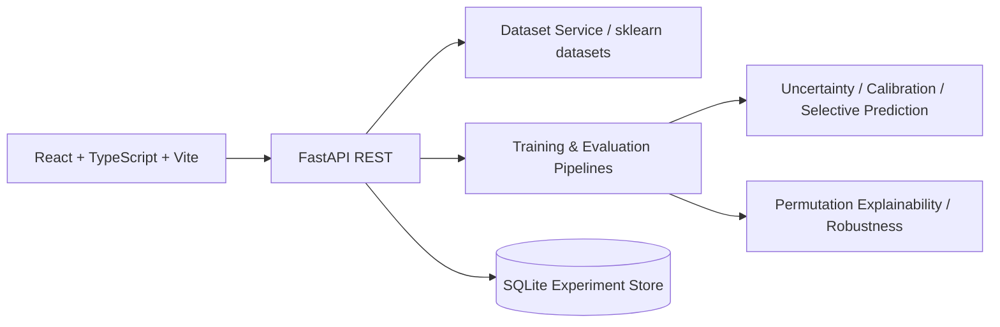

# TrustML — Prediction Reliability & Uncertainty Intelligence Platform

TrustML is a local research and learning application for studying ML classification reliability. It reports predictive performance alongside confidence, normalized entropy, margin, calibration error, selective prediction, robustness, and permutation-based feature reliance.

> Educational research software. The Breast Cancer Wisconsin dataset is not a diagnostic tool. Metrics and uncertainty scores are not guarantees.

## Research question
Can uncertainty estimation, probability calibration, and selective prediction improve prediction reliability without excessively sacrificing predictive performance?

## Current implementation
- Built-in Breast Cancer Wisconsin, Wine, Digits and synthetic classification benchmarks.
- CSV upload and data preview/summary.
- Training: Logistic Regression, Random Forest, Extra Trees, SVM, Gradient Boosting.
- Pipeline imputation/scaling, held-out evaluation, optional cross-validated sigmoid/isotonic calibration.
- Accuracy, precision, recall, F1, ROC-AUC, log loss, multiclass Brier score, confusion matrix, ECE.
- Prediction confidence, normalized entropy, margin and confidence/entropy-based abstention.
- Held-out permutation feature importance.
- Synthetic Gaussian-noise robustness test.
- SQLite experiment history.
- API-backed overview and research pages.

## Architecture


## Stack
Frontend: React, TypeScript, Vite, Tailwind, Recharts, Lucide, React Router, Axios.
Backend: Python, FastAPI, Pydantic, Pandas, NumPy, SciPy, Scikit-learn, SQLite.

## Windows quick start
### Backend
```powershell
cd backend
python -m venv .venv
.\.venv\Scripts\Activate.ps1
pip install -r requirements.txt
python -m uvicorn app.main:app --reload --port 8000
```
Open API docs at http://localhost:8000/docs.

### Frontend
```powershell
cd frontend
npm install
npm run dev
```
Open http://localhost:5173.

## API
- `GET /api/health`
- `GET /api/datasets`
- `POST /api/datasets/upload` (multipart CSV)
- `GET /api/datasets/{dataset_id}/summary`
- `POST /api/train`
- `GET /api/experiments`
- `GET /api/experiments/{experiment_id}`
- `POST /api/predict`
- `POST /api/calibration/analyze?model_id=...`
- `POST /api/uncertainty/analyze?model_id=...`
- `POST /api/selective-prediction/analyze?model_id=...&threshold=...`
- `POST /api/robustness/test?model_id=...&noise=...`
- `POST /api/drift/analyze?reference_key=...&current_key=...`
- `GET /api/models/{model_id}/explain`

## Tests
```powershell
cd backend
pytest -q
```

## Reliability methods
- **Confidence**: maximum class probability; raw model output unless calibration is enabled.
- **Entropy**: `-sum(p log p)`, normalized by `log(number of classes)` for comparisons across class counts.
- **Margin**: largest probability minus second largest; small values indicate close alternatives.
- **ECE**: weighted difference between average confidence and observed accuracy over confidence bins.
- **Brier**: mean squared error of one-hot labels and predicted class probabilities.
- **Selective prediction**: accept when maximum confidence passes a threshold; coverage and accepted-sample accuracy are reported. The UI also plots risk over confidence thresholds.
- **Robustness**: controlled Gaussian noise to numeric features, evaluated against the saved test set.
- **Explainability**: permutation importance on held-out rows; feature reliance, not causation.

## Limitations / future work
- Model registry is process-memory scoped; trained model handles are lost when the backend restarts. Experiment metadata persists in SQLite.
- Uploaded datasets are currently session/process memory scoped.
- Categorical encoding, upload-to-training selection, complete manual prediction schema, ensemble disagreement, full calibration comparison, conformal prediction, and richer drift charts are planned follow-on work.
- Drift route currently supports numerical reference/current data in memory and uses the KS statistic; the current frontend primarily exposes robustness testing.
- Robustness noise uses raw units, so feature-scale-sensitive noise magnitude needs careful interpretation.
- No automatic claim of safer or better models is made from abstention alone.

### Calibration research comparison (Phase 3)

Use `POST /api/calibration/compare` with JSON body:

```json
{
  "model_id": "<model_id returned by training>",
  "methods": ["none", "sigmoid", "isotonic"]
}
```

The endpoint reuses the experiment's train/test partition. The raw estimator is fitted on the training partition; sigmoid and isotonic calibration use cross-validation within that training partition. Each method is then evaluated on the same held-out test partition, returning accuracy, expected calibration error (ECE), multiclass Brier score, log loss, and class-wise reliability curve points. Test metrics are for comparison and must not be used to select a final model without a separate validation protocol.


### Phase 5: Advanced reliability methods

See [`docs/PHASE5_ADVANCED_RELIABILITY.md`](docs/PHASE5_ADVANCED_RELIABILITY.md) for split-conformal classification and numeric/categorical drift endpoints, assumptions, limitations, and example API calls.
